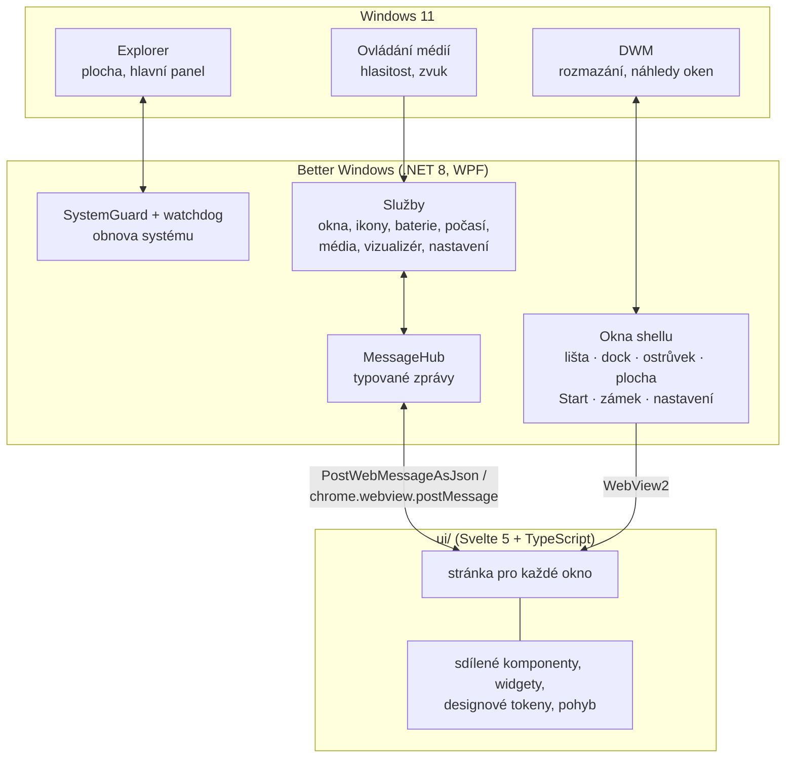

<div align="center">


# Better Windows

**Klidnější a osobnější plocha pro Windows 11.**<br>
Horní lišta, dock, dynamický ostrůvek, widgety a vlastní zamykací obrazovka – nad normálními Windows, bez zásahu do systému.


</div>

> [!WARNING]
> **Projekt je ve stavu alfa.** Všechno je naprogramované, sestavené a otestované automaticky (logika, rozhraní v prohlížeči),
> ale **zatím neběželo na skutečných Windows**. Náhledy výše jsou vykreslené ze skutečných stránek aplikace v prohlížeči;
> systémové rozmazání pod lištou a dockem je v nich simulované. Ruční testy na Windows: [docs/TESTING.md](docs/TESTING.md).

## Obsah

- [Co umí](#co-umí)
- [Náhledy](#náhledy)
- [Animace](#animace)
- [Bezpečnost: systém se vždy vrátí](#bezpečnost-systém-se-vždy-vrátí)
- [Instalace a spuštění](#instalace-a-spuštění)
- [Jak to funguje](#jak-to-funguje)
- [Co ve Windows nejde](#co-ve-windows-nejde)
- [Vývoj](#vývoj)
- [Struktura projektu](#struktura-projektu)
- [Data aplikace](#data-aplikace)
- [Poděkování a upozornění](#poděkování-a-upozornění)

## Co umí

| Část | Co umí |
|---|---|
| **Horní lišta** | Název aktivní aplikace, mini přehrávač, hledání, baterie, počasí, tečky mikrofonu a kamery, jazyk klávesnice, uživatel, hodiny. Rezervuje si místo na obrazovce (AppBar) a schová se u her a videí přes celou obrazovku. |
| **Dock** | Připnuté i spuštěné aplikace s ikonami, zvětšování pod kurzorem, poskakování při spouštění, náhledy oken po najetí myší, kontextová nabídka se seznamem oken, Launchpad a Koš. Pod pásem skutečné systémové rozmazání. |
| **Dynamický ostrůvek** | Černá pilulka nahoře uprostřed: právě hrající hudba (jakákoli aplikace, přes systémové ovládání médií), ovládání a ukazatel hlasitosti. Animace rozbalení je naměřená z referenční nahrávky snímek po snímku. |
| **Plocha a widgety** | Vlastní vrstva plochy pod okny: tapeta, hodiny, kalendář, počasí (Open-Meteo), připomínky, baterie. Volitelně skrytí ikon plochy. |
| **Vizualizér zvuku** | Tečková matice, vlna nebo kruh podle toho, co právě hraje (WASAPI loopback + FFT). |
| **Start / Launchpad** | Všechny aplikace s vyhledáváním podle názvu i počátečních písmen, připnutí do docku, ovládání klávesnicí. Volitelně na klávesu Windows. |
| **Zamykací obrazovka** | Vlastní obrazovka s hodinami a hudbou s editorem rozvržení, zobrazená **před** skutečným zámkem Windows (Win+Shift+L, Start, nebo po nečinnosti). |
| **Motivy** | Předvolby a sdílení přes text (`BW1.…`). Světlý a tmavý režim i barva zvýraznění se řídí podle Windows. |
| **Přístupnost** | Respektuje vypnuté efekty průhlednosti, kontrastní motivy a omezení animací z Windows. Režim výkonu na baterii a při celé obrazovce. |

## Náhledy

<table>
  <tr>
    <td width="50%"></td>
    <td width="50%"></td>
  </tr>
  <tr>
    <td align="center"><sub>Světlý režim – řídí se nastavením Windows</sub></td>
    <td align="center"><sub>Start / Launchpad</sub></td>
  </tr>
  <tr>
    <td></td>
    <td></td>
  </tr>
  <tr>
    <td align="center"><sub>Zamykací obrazovka (před zámkem Windows)</sub></td>
    <td align="center"><sub>Nastavení</sub></td>
  </tr>
</table>

<p align="center">
  <br>
  <sub>Rozbalený ostrůvek s přehrávačem</sub>
</p>

## Animace

Všechny animace jsou pružiny počítané ve skutečném čase – na 60Hz i 144Hz monitoru běží stejně rychle.
Při omezení pohybu ve Windows se vypnou. Záznamy jsou pořízené po snímcích s řízeným časem (60 fps).

<table>
  <tr>
    <td width="50%" align="center"><br><sub><b>Ostrůvek</b> – nafouknutí, stažení, roztažení s rozmazaným obsahem, „želé“ při sbalení</sub></td>
    <td width="50%" align="center"><br><sub><b>Start</b> – obsah naběhne pružinou, rám se systémovým rozmazáním se objeví naráz</sub></td>
  </tr>
  <tr>
    <td align="center"><br><sub><b>Dock</b> – zvětšování pod kurzorem, popisky</sub></td>
    <td align="center"><br><sub><b>Spouštění</b> – skoky s gravitačním průběhem, poslední skok vždy doběhne</sub></td>
  </tr>
</table>

Pohyb ostrůvku je napasovaný na referenční nahrávku (odchylka 1–3 % rozsahu, graf v
[docs/screenshots/animace/ostrovek-krivky.png](docs/screenshots/animace/ostrovek-krivky.png)).
Práce stránky na jeden snímek je v reálném čase pod 1,5 ms u 95 % snímků.

## Bezpečnost: systém se vždy vrátí

Better Windows mění jen to, co jde spolehlivě vrátit, a **nikdy nesmí nechat systém bez hlavního panelu nebo bez ikon plochy**:

- **Před každou změnou** (skrytí hlavního panelu, skrytí ikon plochy) se stav zapíše do `system-state.json`.
- **Při ukončení** i **při pádu** (globální obsluha výjimek) se všechno vrátí.
- **Hlídací proces** (watchdog) vrátí systém, i když aplikaci někdo násilně ukončí ve Správci úloh.
- **Při dalším spuštění** se nedokončená obnova dokončí.
- Chyba v jedné části (např. widgetu) neshodí celou aplikaci; až opakované chyby v krátké době ji ukončí – a obnoví systém.
- Skrytí hlavního panelu je ve výchozím stavu **vypnuté** a před zapnutím se aplikace zeptá.

## Instalace a spuštění

### Požadavky

- Windows 11 22H2 nebo novější (laděno na **25H2**)
- [.NET 8 SDK](https://dotnet.microsoft.com/download) (novější SDK funguje taky)
- [Node.js](https://nodejs.org/) 22 LTS (Vite vyžaduje ≥ 20.19)
- Microsoft Edge WebView2 Runtime (ve Windows 11 je předinstalovaný)

### Spuštění jedním příkazem

```powershell
git clone https://github.com/Zorvoan/windows_addon.git
cd windows_addon
dotnet run --project src/BetterWindows
```

První spuštění samo nainstaluje npm balíčky a sestaví rozhraní v `ui/`. Další buildy ho sestaví znovu, jen když se v `ui/` něco změnilo.
Aplikace se ovládá z ikony v oznamovací oblasti (Nastavení, Ukončit) a z lišty.

> [!TIP]
> Když se něco pokazí: ikona v oznamovací oblasti › **Obnovit ikony plochy a hlavní panel**, nebo aplikaci ukonči
> (ikona › Ukončit, případně tlačítko **Ukončit** v liště) – plocha i hlavní panel se vrátí do původního stavu.
> Logy jsou v `%AppData%\BetterWindows\logs\`.

## Jak to funguje

Každá část shellu je samostatné okno **WPF (.NET 8)** bez rámečku s průhledným **WebView2**. Rozhraní je **Svelte 5 + TypeScript**,
sestavené Vite a načtené ze složky přes virtuální doménu (žádný lokální server). C# a stránky si posílají typované zprávy `{type, payload}`.
Win32 API se volá přes **CsWin32** (generované P/Invoke).



Vrstvy oken odspodu: **plocha** (vložená pod ikony plochy, záloha „okno vespod“) → běžné aplikace → **dock** (+ samostatné okno se
systémovým rozmazáním pod pásem) → **lišta** → **ostrůvek**. Okna docku a ostrůvku mají tvar podle obsahu (`SetWindowRgn`),
takže kliknutí mimo ně jde do aplikací pod nimi. Podrobnosti: [docs/ARCHITECTURE.md](docs/ARCHITECTURE.md).

## Co ve Windows nejde

Některé věci z macOS ve Windows udělat spolehlivě nejde – Better Windows je neobchází potichu:

| Nejde | Proč / co místo toho |
|---|---|
| Nahradit zamykací a přihlašovací obrazovku Windows | Běží na zabezpečené ploše (Winlogon). Better Windows ukazuje vlastní obrazovku **před** zámkem; ta **není zabezpečení**, chrání jen skutečný zámek Windows. |
| Oznámení cizích aplikací v ostrůvku | Vyžaduje identitu balíčku (MSIX). |
| Animace cizích oken (např. minimalizace do docku) | Kreslí je Windows. |
| Globální nabídky aplikací v liště (Soubor, Úpravy…) | Většina dnešních aplikací (Chromium, Electron, UWP, WinUI) žádnou čitelnou nabídku nemá. |
| Ovládat aplikace spuštěné jako správce | Ochrana Windows (UIPI) – dock je nemusí umět přepnout ani zavřít. |

Seznam známých rizik je v [docs/TESTING.md](docs/TESTING.md#kde-jsou-známá-rizika-ať-víš-co-čekat).

## Vývoj

```powershell
dotnet build                       # sestavení (včetně rozhraní)
dotnet test                        # testy logiky + vygeneruje data pro harness
cd ui; npm run harness             # všechny stránky v headless Chromiu, světlý i tmavý režim, interakce
```

Testy logiky i harness běží i na Linuxu – rozhraní se dá ladit bez Windows.

**Rychlá smyčka při ladění rozhraní:**

1. Spusť aplikaci (`dotnet run --project src/BetterWindows`).
2. Ve druhém terminálu spusť `npm run watch` ve složce `ui/` – Vite při každé změně přestaví `ui/dist`.
3. V okně stiskni **Ctrl+R**. Debug build čte rozhraní přímo z `ui/dist`, C# není potřeba znovu sestavovat.

V Debug buildu fungují v každém okně vývojářské nástroje (**F12**).

**Designové tokeny** (barvy, sklo, zaoblení, písmo, pohyb pro světlý i tmavý režim) jsou na jednom místě:
[`ui/src/lib/styles/tokens.css`](ui/src/lib/styles/tokens.css). Pružiny a pohyb z JS: [`ui/src/lib/motion.svelte.ts`](ui/src/lib/motion.svelte.ts).

## Struktura projektu

```
src/BetterWindows/          WPF aplikace (.NET 8)
  Core/                       spuštění, obnova systému (SystemGuard, watchdog), CrashGuard, log
  Bridge/                     zprávy C# ↔ JS
  Native/                     Win32: DWM, AppBar, vložení do plochy, háčky klávesnice
  Services/                   okna, ikony, dock, média, hlasitost, vizualizér, počasí, Start, zámek…
  ShellWindows/               okna shellu (lišta, dock, ostrůvek, plocha, Start, zámek, nastavení)
src/BetterWindows.Logic/    čistá logika bez WPF (nastavení, zprávy, FFT, motivy…) – testovatelná kdekoli
tests/                      testy logiky (xUnit) + kontrakt zpráv pro harness
ui/                         rozhraní (Svelte 5 + TypeScript + Vite)
  src/apps/                   jedna složka = jedno okno
  src/lib/                    sdílené komponenty, widgety, tokeny, pohyb, most do C#
  harness/                    kontrola stránek v headless Chromiu
tools/make_icon.py          generátor vlastní ikony
docs/                       architektura, roadmapa, testy na Windows, náhledy
```

## Data aplikace

| Co | Kde |
|---|---|
| Nastavení | `%AppData%\BetterWindows\settings.json` |
| Data widgetů (připomínky) | `%AppData%\BetterWindows\widgets-data.json` |
| Pojistka změn systému | `%AppData%\BetterWindows\system-state.json` (jen když je něco změněno) |
| Logy (7 dní) | `%AppData%\BetterWindows\logs\` |
| Cache WebView2, ikon, tapety | `%LocalAppData%\BetterWindows\` |

## Poděkování a upozornění

Postaveno na [WebView2](https://learn.microsoft.com/microsoft-edge/webview2/), [CsWin32](https://github.com/microsoft/CsWin32),
[NAudio](https://github.com/naudio/NAudio), [Svelte](https://svelte.dev/), [Vite](https://vite.dev/) a písmu
[Inter](https://rsms.me/inter/). Počasí poskytuje [Open-Meteo](https://open-meteo.com/).

Better Windows není spojený se společnostmi Apple ani Microsoft. Inspiruje se macOS, ale ikony, grafika i vzhled jsou vlastní –
nepoužívá žádná loga ani obrázky Applu.

Licence zatím není určena.
