<div align="center">

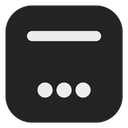

# Better Windows

**A calmer, more personal desktop for Windows 11.**<br>
A top bar, dock, dynamic island, widgets and a custom lock screen — layered on top of regular Windows, without modifying the system.


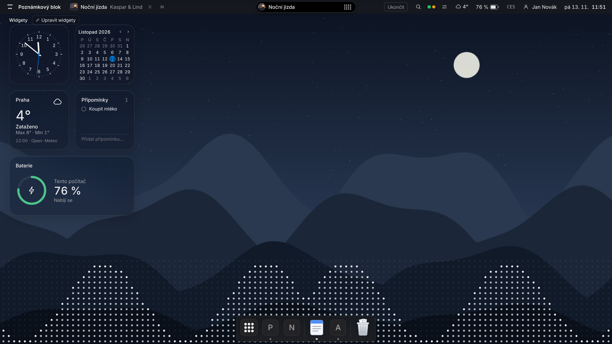

</div>

> [!WARNING]
> **This project is in alpha.** Everything is implemented, builds, and passes automated checks (logic tests, UI rendered in a browser),
> but it **has not run on real Windows yet**. The previews above are rendered from the app's actual pages in a browser;
> the system blur under the top bar and dock is simulated. Manual test plan for Windows: [docs/TESTING.md](docs/TESTING.md) (in Czech).

The user interface is currently in Czech.

## Contents

- [Features](#features)
- [Screenshots](#screenshots)
- [Animations](#animations)
- [Safety: the system always comes back](#safety-the-system-always-comes-back)
- [Installation](#installation)
- [How it works](#how-it-works)
- [What Windows doesn't allow](#what-windows-doesnt-allow)
- [Development](#development)
- [Project structure](#project-structure)
- [App data](#app-data)
- [Credits and disclaimer](#credits-and-disclaimer)
- [License](#license)

## Features

| Part | What it does |
|---|---|
| **Top bar** | Active app name, mini player, search, battery, weather, microphone and camera indicators, keyboard language, user, clock. Reserves screen space (AppBar) and hides for full-screen games and videos. |
| **Dock** | Pinned and running apps with their icons, magnification under the cursor, bounce on launch, window previews on hover, a context menu listing open windows, Launchpad and Trash. Real system blur behind the dock. |
| **Dynamic island** | A black pill at the top center: now playing (any app, via the system media controls), playback controls and a volume indicator. Audio-reactive waveform tinted with the album art's colors, long titles scroll back and forth, and a playing app **flies into the island** when you minimize it. The expand animation is measured frame by frame from a reference recording. |
| **Desktop and widgets** | A custom desktop layer beneath all windows: wallpaper, clock, calendar, weather (Open-Meteo), reminders, battery. Content insets follow the card corner radius. Optionally hides the desktop icons. |
| **Audio visualizer** | Dot matrix, wave or ring driven by whatever is playing (WASAPI loopback + FFT). |
| **Start / Launchpad** | All apps with search by name or initials, pin to dock, full keyboard control. Optionally opened with the Windows key. |
| **Lock screen** | A custom screen with clock and music, with a layout editor, shown **before** the real Windows lock (Win+Shift+L, Start, or after inactivity). |
| **Themes** | Presets and sharing via a text code (`BW1.…`). Light/dark mode and accent color follow Windows. |
| **Language** | The whole interface follows the Windows display language: Czech and Slovak get Czech, every other language gets English. Dates and numbers use the Windows format. |
| **Accessibility** | Respects Windows' transparency effects, contrast themes and reduced motion settings. Performance mode on battery and in full screen. |

## Screenshots

<table>
  <tr>
    <td width="50%">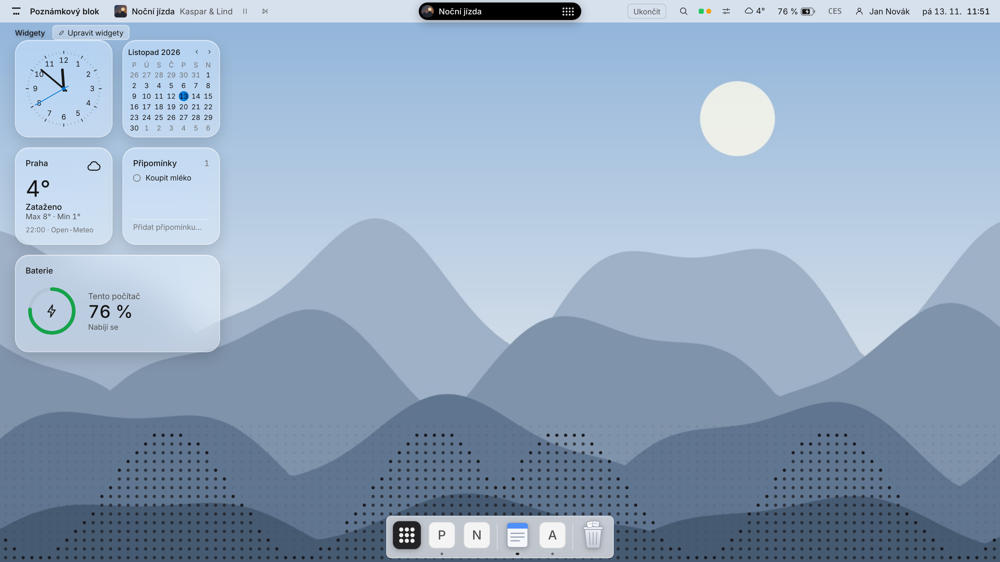</td>
    <td width="50%">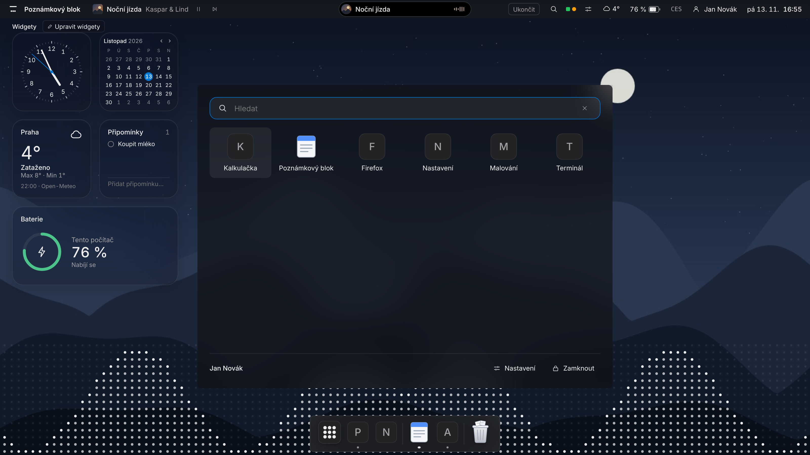</td>
  </tr>
  <tr>
    <td align="center"><sub>Light mode — follows your Windows setting</sub></td>
    <td align="center"><sub>Start / Launchpad</sub></td>
  </tr>
  <tr>
    <td>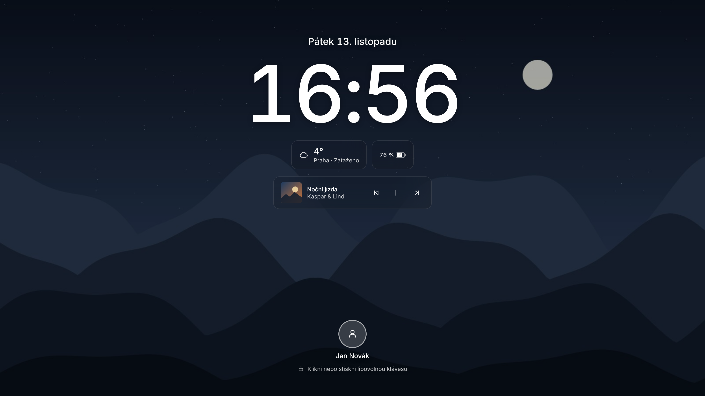</td>
    <td>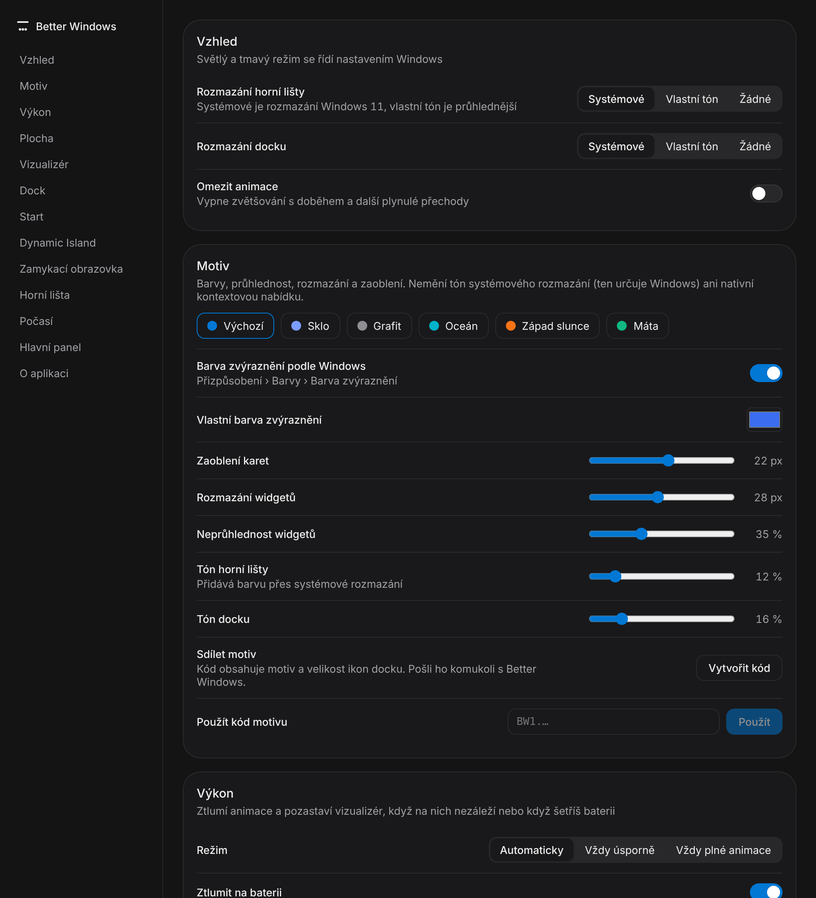</td>
  </tr>
  <tr>
    <td align="center"><sub>Lock screen (shown before the Windows lock)</sub></td>
    <td align="center"><sub>Settings</sub></td>
  </tr>
</table>

<p align="center">
  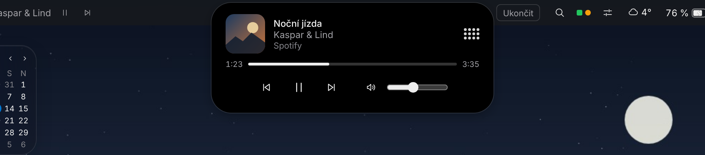<br>
  <sub>Expanded island with the media player</sub>
</p>

## Animations

All animations are springs simulated in real time, so they run at the same speed on 60 Hz and 144 Hz displays.
They turn off when reduced motion is enabled in Windows. The recordings below were captured frame by frame with a controlled clock (60 fps).

<table>
  <tr>
    <td width="50%" align="center">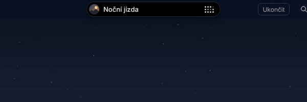<br><sub><b>Island</b> — swell, squeeze, expand with blurred content, jelly wobble on collapse</sub></td>
    <td width="50%" align="center">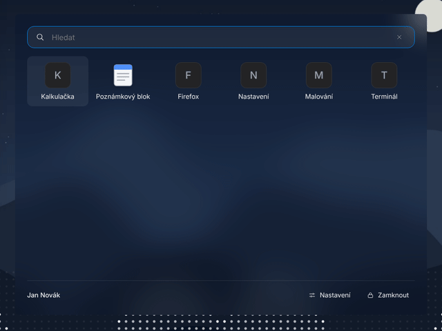<br><sub><b>Start</b> — content springs in; the system-blurred frame appears at once</sub></td>
  </tr>
  <tr>
    <td align="center">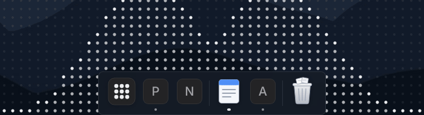<br><sub><b>Dock</b> — gentle magnification under the cursor, labels</sub></td>
    <td align="center">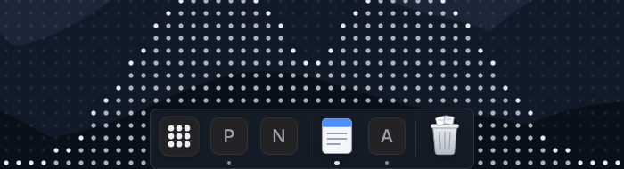<br><sub><b>Launch</b> — gravity-shaped bounces; the last bounce always finishes</sub></td>
  </tr>
</table>

<p align="center">
  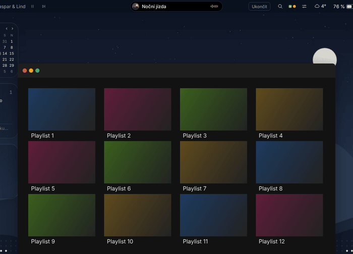<br>
  <sub><b>Into the island</b> — minimizing the app that's playing sends a live preview of its window into the island, which swallows it with a little swell. (Simulated here with a mock window; on Windows the preview is drawn by DWM.)</sub>
</p>

The island's motion is fitted to a reference recording (1–3 % deviation of the motion range, see the
[curve comparison](docs/screenshots/animace/ostrovek-krivky.png)). Page work per frame stays under 1.5 ms in real time for 95 % of frames.

## Safety: the system always comes back

Better Windows only changes what can be reliably restored, and it must **never leave you without a taskbar or desktop icons**:

- **Before every change** (hiding the taskbar or the desktop icons) the original state is written to `system-state.json`.
- **On exit** and **on crash** (global exception handler) everything is restored.
- **A watchdog process** restores the system even if the app is killed from Task Manager.
- **On next launch** any unfinished restore is completed.
- A failure in one part (e.g. a widget) doesn't bring down the app; only repeated errors in a short time shut it down — and restore the system.
- Hiding the taskbar is **off by default**, and the app asks for confirmation before turning it on.

## Installation

### Requirements

- Windows 11 22H2 or later (tuned for **25H2**)
- [.NET 8 SDK](https://dotnet.microsoft.com/download) (newer SDKs work too)
- [Node.js](https://nodejs.org/) 22 LTS (Vite requires ≥ 20.19)
- Microsoft Edge WebView2 Runtime (preinstalled on Windows 11)

### Run with one command

```powershell
git clone https://github.com/Zorvoan/windows_addon.git
cd windows_addon
dotnet run --project src/BetterWindows
```

The first run installs the npm packages and builds the UI in `ui/` automatically. Later builds rebuild the UI only when something in `ui/` has changed.
The app is controlled from its notification area (tray) icon — Settings, Exit — and from the top bar.

> [!TIP]
> If something goes wrong: tray icon › **Restore desktop icons and taskbar** (*Obnovit ikony plochy a hlavní panel*), or exit the app
> (tray icon › Exit, or the **Exit** (*Ukončit*) button in the top bar) — the desktop and taskbar return to their original state.
> Logs are in `%AppData%\BetterWindows\logs\`.

## How it works

Each part of the shell is a separate borderless **WPF (.NET 8)** window hosting a transparent **WebView2**. The UI is **Svelte 5 + TypeScript**,
built with Vite and loaded from a folder through a virtual host name (no local server). C# and the pages exchange typed `{type, payload}` messages.
Win32 APIs are called through **CsWin32** (generated P/Invoke).

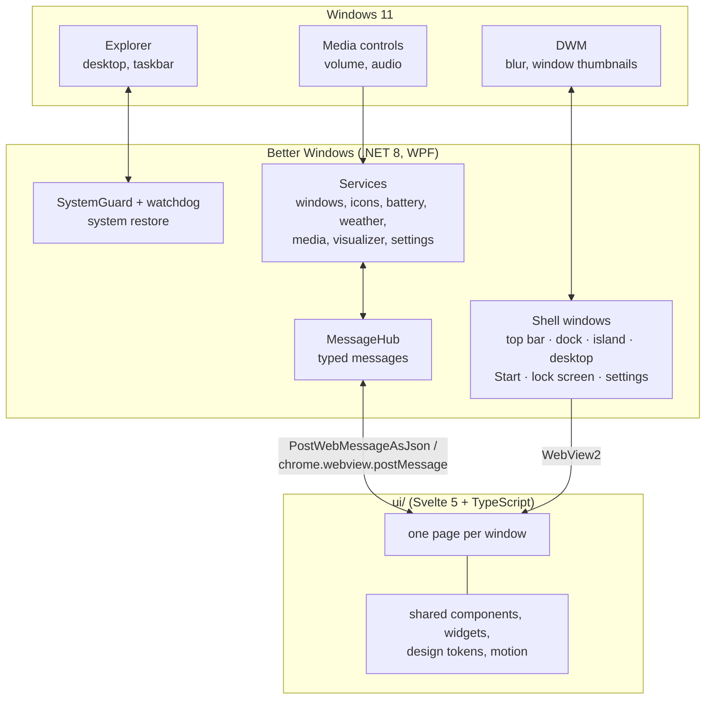

Window layers, bottom to top: **desktop** (embedded below the desktop icons, falling back to a bottom-most window) → regular apps → **dock**
(plus a separate system-blur window behind the dock) → **top bar** → **island**. The dock and island windows are shaped to their content
(`SetWindowRgn`), so clicks outside them reach the apps underneath. Details: [docs/ARCHITECTURE.md](docs/ARCHITECTURE.md) (in Czech).

## What Windows doesn't allow

Some macOS features can't be done reliably on Windows — Better Windows doesn't silently hack around them:

| Not possible | Why / what instead |
|---|---|
| Replacing the Windows lock and sign-in screens | They run on the secure desktop (Winlogon). Better Windows shows its own screen **before** the lock; it is **not a security feature** — only the real Windows lock protects you. |
| Notifications from other apps in the island | Requires package identity (MSIX). |
| Animating other apps' windows (e.g. minimizing into the dock) | Windows draws those. |
| Global app menus in the top bar (File, Edit…) | Most current apps (Chromium, Electron, UWP, WinUI) expose no readable menu. |
| Controlling apps running as administrator | Windows protection (UIPI) — the dock may not be able to switch to or close them. |
| Replacing the Windows minimize animation | Windows draws it; with animation effects on, it plays alongside the fly-into-the-island animation. |
| Typing directly into the desktop layer | The desktop layer lives inside Explorer's desktop window, which keeps keyboard focus. Clicking a text field in a widget opens a real input field exactly over it instead. |

Known risks are listed in [docs/TESTING.md](docs/TESTING.md#kde-jsou-známá-rizika-ať-víš-co-čekat) (in Czech).

## Development

```powershell
dotnet build                       # build (including the UI)
dotnet test                        # logic tests; also generates the harness fixtures
cd ui; npm run harness             # every page in headless Chromium, light and dark, with interactions
```

The logic tests and the UI harness also run on Linux, so the UI can be developed without Windows.

**Fast UI loop:**

1. Start the app (`dotnet run --project src/BetterWindows`).
2. In a second terminal, run `npm run watch` in `ui/` — Vite rebuilds `ui/dist` on every change.
3. Press **Ctrl+R** in a window. A Debug build reads the UI straight from `ui/dist`, so the C# side doesn't need rebuilding.

Developer tools (**F12**) work in every window in Debug builds.

**Design tokens** (colors, glass, corner radii, typography and motion for light and dark mode) live in one place:
[`ui/src/lib/styles/tokens.css`](ui/src/lib/styles/tokens.css). Springs and JS-driven motion: [`ui/src/lib/motion.svelte.ts`](ui/src/lib/motion.svelte.ts).

## Project structure

```
src/BetterWindows/          WPF app (.NET 8)
  Core/                       startup, system restore (SystemGuard, watchdog), CrashGuard, logging
  Bridge/                     C# ↔ JS messaging
  Native/                     Win32: DWM, AppBar, desktop embedding, keyboard hooks
  Services/                   windows, icons, dock, media, volume, visualizer, weather, Start, lock screen…
  ShellWindows/               shell windows (top bar, dock, island, desktop, Start, lock screen, settings)
src/BetterWindows.Logic/    pure logic without WPF (settings, messages, FFT, themes…) — testable anywhere
tests/                      logic tests (xUnit) + message contract for the harness
ui/                         user interface (Svelte 5 + TypeScript + Vite)
  src/apps/                   one folder per window
  src/lib/                    shared components, widgets, tokens, motion, bridge to C#
  harness/                    page checks in headless Chromium
tools/make_icon.py          generator for the app's own icon
docs/                       architecture, roadmap, Windows test plan, screenshots (in Czech)
```

## App data

| What | Where |
|---|---|
| Settings | `%AppData%\BetterWindows\settings.json` |
| Widget data (reminders) | `%AppData%\BetterWindows\widgets-data.json` |
| System change safeguard | `%AppData%\BetterWindows\system-state.json` (only while something is changed) |
| Logs (7 days) | `%AppData%\BetterWindows\logs\` |
| WebView2, icon and wallpaper cache | `%LocalAppData%\BetterWindows\` |

## Credits and disclaimer

Built with [WebView2](https://learn.microsoft.com/microsoft-edge/webview2/), [CsWin32](https://github.com/microsoft/CsWin32),
[NAudio](https://github.com/naudio/NAudio), [Svelte](https://svelte.dev/), [Vite](https://vite.dev/) and the
[Inter](https://rsms.me/inter/) typeface. Weather data by [Open-Meteo](https://open-meteo.com/).

Better Windows is not affiliated with Apple or Microsoft. It is inspired by macOS, but all icons, graphics and visual design are original —
it uses no Apple logos or images.

## License

Released under the [MIT License](LICENSE) © 2026 Zdeněk Patík.
Third-party components keep their own licenses (the bundled Inter typeface is under the SIL Open Font License 1.1).
